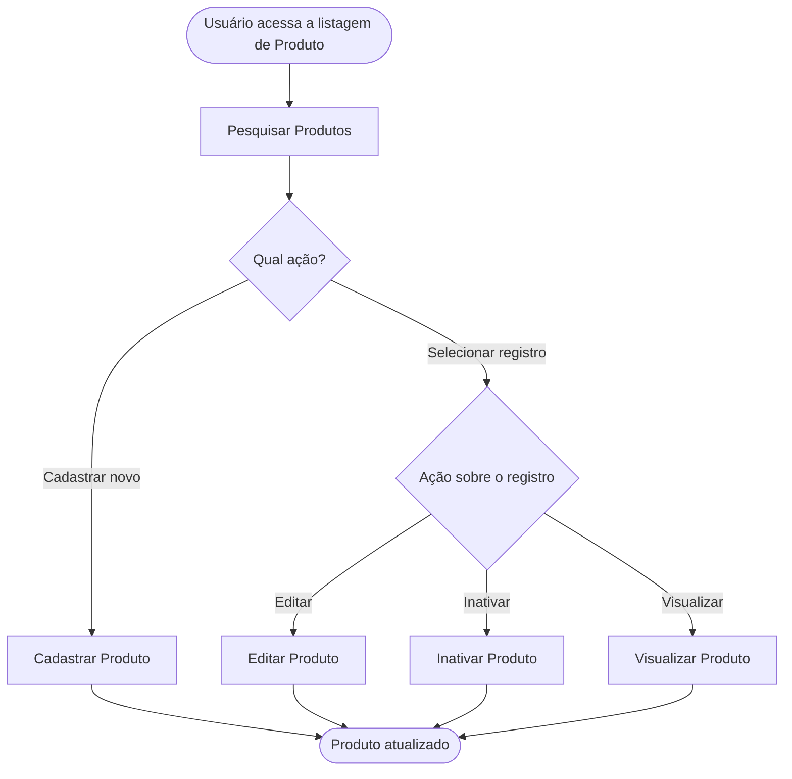

<!-- docqui: 8.3.1 | prompt: IDS_N3 | atualizado: 2026-10-31 -->
# Agrupamento Funcional: Produtos
> **Nível 2** - Domínio: Catálogo - `CAT-PRD`

## Descrição

Reúne as operações de manutenção dos produtos à venda: pesquisar, cadastrar, editar, inativar e visualizar um produto. Permite ao gestor de catálogo manter nome, preço e quantidade em estoque e retirar um produto de venda sem apagá-lo dos pedidos antigos.

**Não faz**: excluir um produto definitivamente, organizar categorias (Categorias), decidir o que aparece em destaque (Vitrine › Destaques) nem comprar, repor ou controlar fisicamente o estoque.

## Funcionalidades

<!-- docqui:n3-ids {"version":1,"ids":{"CAT-PRD-01":"f-pesquisar-produto.md","CAT-PRD-02":"f-cadastrar-produto.md","CAT-PRD-03":"f-editar-produto.md","CAT-PRD-04":"f-inativar-produto.md","CAT-PRD-05":"f-visualizar-produto.md"}} -->

| Funcionalidade | Descrição |
|---|---|
| [**Pesquisar Produtos**](f-pesquisar-produto.md) <small>CAT-PRD-01</small> | Encontrar produtos por nome, categoria e situação |
| [**Cadastrar Produto**](f-cadastrar-produto.md) <small>CAT-PRD-02</small> | Incluir produto com nome único, preço, quantidade em estoque e categoria |
| [**Editar Produto**](f-editar-produto.md) <small>CAT-PRD-03</small> | Alterar os dados do produto e devolvê-lo à venda; o nome não muda |
| [**Inativar Produto**](f-inativar-produto.md) <small>CAT-PRD-04</small> | Retirar o produto de venda, mantendo-o nos pedidos antigos |
| [**Visualizar Produto**](f-visualizar-produto.md) <small>CAT-PRD-05</small> | Ver os dados do produto, sem alterá-los |

## Fluxo Principal

## Dependências entre funcionalidades

- **Pesquisar Produtos** é o ponto de entrada; **Cadastrar Produto** independe das demais, mas exige ao menos uma categoria (Categorias).
- **Editar Produto**, **Inativar Produto** e **Visualizar Produto** exigem um produto existente, alcançado pela pesquisa.
- **Inativar Produto** é a saída de venda; um produto inativo volta à venda em **Editar Produto**, que altera a Situação.

## Telas

| Tela | Rota sugerida | Funcionalidades atendidas | Descrição |
|---|---|---|---|
| Pesquisa de Produtos | `/catalogo/produtos` | **Pesquisar Produtos** <small>CAT-PRD-01</small> **Cadastrar Produto** <small>CAT-PRD-02</small> **Editar Produto** <small>CAT-PRD-03</small> **Inativar Produto** <small>CAT-PRD-04</small> **Visualizar Produto** <small>CAT-PRD-05</small> | Filtros e lista dos produtos; cadastro, edição e visualização abrem em modal sobre a pesquisa, e a inativação é ação na linha |

## Permissões por perfil

> **Fonte única de permissões** deste Agrupamento Funcional. As funcionalidades (N3) não tratam de perfis nem permissões; qualquer acesso novo ou diferente entra nesta matriz.

Perfis: **Gestor de catálogo**, **Administrador**.

| Perfil | Pesquisar | Cadastrar | Editar | Inativar | Visualizar |
|---|---|---|---|---|---|
| **Gestor de catálogo** | ✓ | ✓ | ✓ | ✓ | ✓ |
| **Administrador** | ✓ | — | — | — | ✓ |

* **Gestor de catálogo** — mantém os produtos.
* **Administrador** — consulta, sem alterar.

## Changelog

| Data | Autor | Tipo | Descrição |
|---|---|---|---|
| 2026-10-31 | ids-n3 | IDs reservados | Registro dos IDs existentes, sem renumeração; IDs imutáveis. |
| 2026-10-31 | Claude | N2 criado | CRUD de Produtos gerado pelo PROMPT CRUD a partir do ticket fictício STRY0013150; Inativar no lugar de Excluir; cadastro, edição e visualização em modal; sem aprovação de checkpoint. |

*Links: [N1 Catálogo](../README.md) · [INDEX geral](../../INDEX.md)*
